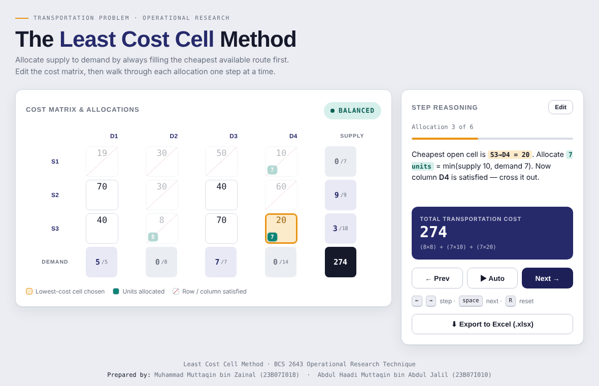

# LCC Transportation Solver

An interactive web app that solves the **Transportation Problem** using the **Least Cost Cell (LCC) Method**, one allocation at a time. Built for the BCS 2643 Operational Research Technique course.

🔗 **Live demo:** https://taqinzai.github.io/lcc-transportation/



## Features

- **Editable problem setup**: up to 8 sources × 8 destinations, with custom costs, supply and demand
- **Step-by-step solving**: each step highlights the cheapest open cell, shows how many units are allocated and explains why
- **Playback controls**: Prev, Next and Auto play, plus keyboard shortcuts
- **Unbalanced problems**: automatically adds a dummy row or column when total supply and demand differ
- **Running total cost**: shows the cost breakdown as allocations are made
- **Export to Excel**: download the full solution as an `.xlsx` file
- **Works offline**: a single HTML file with no build step or server needed

## How the method works

1. Pick the cell with the lowest cost among rows and columns that are not yet satisfied.
2. Allocate as many units as possible: `min(remaining supply, remaining demand)`.
3. Cross out the row or column that becomes satisfied.
4. Repeat until all supply and demand are allocated.
5. Total cost = sum of (allocated units × unit cost) for every allocated cell.

## Usage

Open the live demo, or run it locally:

```bash
git clone https://github.com/taqinzai/lcc-transportation.git
cd lcc-transportation
# open index.html in any modern browser
```

Then:

1. Set the number of sources and destinations.
2. Fill in the cost matrix, supply and demand.
3. Click **Solve step by step**.
4. Step through with **Next** / **Prev**, or press **Auto**.
5. Click **Export to Excel** to save the result.

### Keyboard shortcuts

| Key | Action |
| --- | --- |
| `→` / `Space` | Next step |
| `←` | Previous step |
| `R` | Reset |

## Tech stack

- HTML, CSS and vanilla JavaScript
- [SheetJS](https://sheetjs.com/) for Excel export (embedded for offline use)

## Authors

- Muhammad Muttaqin bin Zainal
- Abdul Haadi Muttaqin bin Abdul Jalil
Practice branch test 
